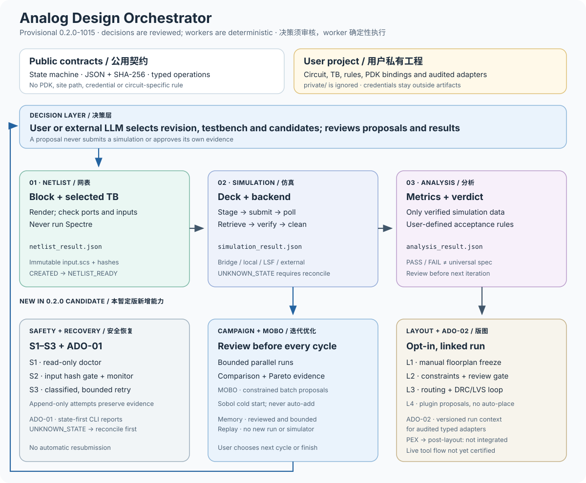

# Analog Design Orchestrator（ADO）

**让模拟 IC 设计的每次交接可复现、可审核。** ADO 用确定性的 Python worker 串起网表、仿真与分析。电路决策由设计者或外部控制器作出；各 worker 只执行自己的角色，以带 SHA-256 哈希的 JSON 文件交接。

[English](README.md) · [MIT 许可证](LICENSE)

> **`0.2.0-1015` 暂定快照。** 该分支供审核，不代表已认证的 PDK、集群或物理设计版本。为兼容既有工程，Python 包和 CLI 仍叫 `analog-agent`；包版本为 `0.2.0.dev1015`。这不表示已发布到 PyPI。



## 架构与责任边界

| 边界 | 职责 | 持久证据 |
|---|---|---|
| 决策层 | 用户或外部 LLM 选择电路版本、TB 和候选点，再审核结果；提案不会自动提交。 | Campaign 点位与决策 |
| 网表 worker | 渲染项目定义的 block 与 TB；不启动仿真器。 | `netlist_result.json`、不可变 `input.scs`、输入哈希 |
| 仿真 worker | 生成 deck，暂存、提交、轮询、回传，并同时验证调度器和仿真器结果；负责远端清理。 | 提交/回传回执、`simulation_result.json` |
| 分析 worker | 只分析已验证结果，按项目规则测量；不暗中重跑 Spectre。 | `analysis_result.json`、图、判定和审核 |
| 可选版图流程 | 关联已审核原理图 run，冻结约束和 floorplan，再经审计的 typed adapter 布线、运行 DRC/LVS。 | 独立 `layouts/<id>/` 交接与哈希 |

`runs/<id>/` 与 `layouts/<id>/` 是独立状态机。每阶段开始前核对被钉住的输入哈希；发现变更时拒绝继续且不推进状态。提交回执缺失或冲突属于 **UNKNOWN_STATE**，不能据此重投。`analog-agent recover RUN_DIR` 只检查中断证据，不提交作业；必须先查实远端作业再协调。监控器报告停滞但不自动重投。安全重试在新 attempt 目录保留既有证据；详见[错误恢复](docs/failure-recovery.md)和[任务安全](docs/task-safety.md)。

公用代码不含 PDK 规则、站点路径、凭据或电路专属策略。用户工程的 `private/` 提供这些集成，并应被项目 Git 忽略。`private.example/` 只说明接口，不是现成的集群或 Virtuoso 适配器。项目内 Python 插件及 `workflow.role_commands` 属于可信可执行配置，并非沙盒。只有经审核的私有记忆才能进入受限决策上下文。

## 本快照已实现什么

- **安全 S1–S3：**只读 `doctor`；`verify_inputs` 与任务监控；失败分类、有上限的重试及追加式 attempt 证据。**ADO-01：**仿真 CLI 先读状态，正确报告合法 `STAGED` 并要求协调不确定证据。**ADO-02：**typed 版图适配器获得版本化、受 run 目录约束的上下文。
- **设计探索：**有界 campaign、可选的带约束多目标 BO、经审核的记忆与离线回放。**版图 L1–L4：**关联 run 和手工 floorplan；冻结约束；经审核的布线/DRC/LVS 回路；只输出提案的 floorplan 插件。
- 不可变的 `CREATED → NETLIST_READY → STAGED → SUBMITTED → RUN → DONE → RETRIEVED → VERIFIED → ANALYZED` 交接；短作业可合法跳过某些运行态，失败有明确状态，并保留输入哈希和经审核的下一轮决策。`PASS` 只说明**该项目自己的**规则通过。
- 可复用电路 block、独立 TB、DC/AC/STB/瞬态规则、通用波形/眼图/FFT 工具及项目指标插件；兼容原单文件网表。
- `bridge`、`local`、异步 `lsf`、`external` 后端接口。LSF 和 external 需要经站点验证的私有适配器；external 只暂存 deck，**不会自行提交**。
- 有界并行的持久 campaign、显式审核关卡、只读回放、经审核的私有记忆，以及可选的[多目标贝叶斯提案器](docs/mobo.md)（`.[bo]`）。提案器只给候选点，仍须用户执行 `campaign add`。
- 只读 `doctor`、阶段输入哈希关卡、心跳监控和分类恢复；这些检查不代表真实集群或 PDK 已通过验收。
- **可选的版图框架**：关联版图 run、审核约束、手工或插件提案 floorplan、确定性 diff/score、仅写 JSON 的布线方案、typed DRC/LVS 交接。现有测试使用假适配器。真实部署仍须提供经审计的私有布局读取、布线、LVS 源网表和验证适配器；ADO 不声称已有真实反相器版图通过 DRC/LVS。

## 安装与本地交接试跑

使用现有的 Python 3.10+ 环境。ADO 不安装 Spectre、Virtuoso、PDK 或许可证。

```sh
python -m pip install -e .
# 可选：python -m pip install -e '.[analysis]'
# 可选：python -m pip install -e '.[bo]'
analog-agent doctor
analog-agent new project.example.json
```

`project.example.json` 是相对本仓库路径的 RC 示例。`new` 只准备网表 run，**不能证明仿真环境可用**。未配置后端及私有依赖前不要执行 `submit`。独立工程可参考 `project.example.json` 和 `private.example/` 的**结构**，再填写自己的 block、TB、规则、指标、模型 include 与后端。凭据不得写入 JSON、命令参数、产物或 Git。

已配置工程的手动流程：

```sh
analog-agent new PROJECT.json --testbench ac
analog-agent submit RUN_DIR
analog-agent status RUN_DIR
analog-agent resume RUN_DIR       # 仅异步后端；每次轮询一次
analog-agent analyze RUN_DIR      # VERIFIED 后
analog-agent decide-run RUN_DIR --decision iterate --to netlist --reason "已审核证据"
```

`analog-agent duty RUN_DIR` 显示当前仍负责交接的角色。中断后先用 `inspect` 和 `recover` 检查；队列接受任务或进程退出都不等于仿真成功。external worker 合法停在 `STAGED` 时，`submit` 只报告暂存结果和后续提交责任，不创建提交文件。证据冲突返回退出码 3 的 `UNKNOWN_STATE`，须先协调。

## Campaign 与版图入口

```sh
analog-agent campaign new PROJECT.json
analog-agent campaign add CAMPAIGN_DIR POINTS.json
analog-agent campaign run CAMPAIGN_DIR --max-seconds 3600
analog-agent campaign status CAMPAIGN_DIR
```

每轮生成供审核的比较报告。私有提案器或可选 MOBO 提案器可以建议下一批，但都不能提交。[离线回放](examples/replay_history.json)只检验记录的决策，不创建 run 或运行仿真器。对话/token 中断后，先用 `campaign doctor` 和 `campaign brief` 恢复持久状态。

版图从 `analog-agent layout prepare SCHEMATIC_RUN_DIR` 开始，前提是原理图 run 已完成验证及审核关卡。用户先冻结[约束](docs/layout-constraints.md)，比对并冻结 live [floorplan](docs/layout.md)，明确放行布线，然后进入 [typed 布线与验证](docs/layout-routing.md)。[插件生成的 floorplan](docs/layout-floorplan-plugin.md)仅是提案，绝不自动摆放或冻结。DRC/LVS clean 必须有对应的已保存 cellview 和 LVS 源网表证据，而不只是工具退出码为零。真实工具适配器与工艺规则保持私有，并须独立验证。

PEX 与后仿**尚不是集成的 ADO 阶段**。原则上私有提取器可以生成寄生网表，再用新的仿真 run 处理；但当前版图状态机尚未钉住 cellview → PEX → 后仿结果的同源哈希链，也没有对应审核关卡。因此不能把这种手工拼接表述为已验证的版图端到端流程。

## 文档与验证

- [角色总则](AGENTS.md)、[网表](agents/netlist.md)、[仿真](agents/simulation.md)、[分析](agents/analysis.md)
- [安全体检](docs/doctor.md)、[哈希关卡与监控](docs/task-safety.md)、[错误恢复](docs/failure-recovery.md)
- [MOBO 契约](docs/mobo.md)和[合成基准](docs/bench_mobo.md)
- [布局 Bridge 审计](docs/design/layout-bridge-api.md)、[版图契约](docs/layout.md)、[仿真成本设计](docs/design/simulation-cost.md)

测试命令为 `python -m unittest discover -s tests -q`。CI 还会运行只读 doctor，并使用哈希锁定的测试依赖。假后端测试验证公用契约，不能替代站点实际登录、传输哈希、仿真日志、回传、远端清理或原生 DRC/LVS 证据。本暂定快照供稳定版 `0.2.0` 决策前审核。

Python 通用 gm/Id 查表、尺寸计算、桌面界面与优化器接线见 [使用说明](docs/gmid.zh-CN.md)。支持统一 SI CSV 和显式旧表映射；真实工艺表仅保留在项目 private/。示例位于 examples/gmid，全部为合成数据。

公开包边界与wheel/sdist检查见[发布检查](docs/public-release.md)。支持明确的单工艺角、单温度表；不对未表征条件外推。
