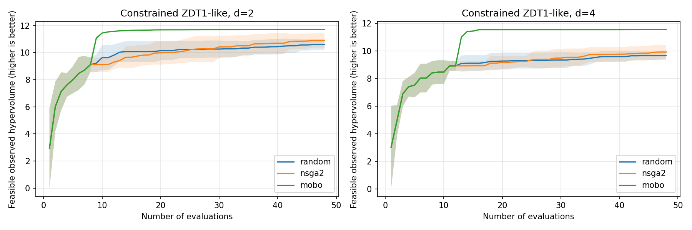

# MOBO equal-budget synthetic benchmark

Measured on 2026-10-11, Windows, existing conda SLiCAP Python 3.13.12, CPU double
precision. **No simulator, EDA server, private project or ADO run was used.**

## Reproduce

Install the optional stack and benchmark-only packages:

```sh
python -m pip install -e '.[bo]' pymoo matplotlib
# Set PYTHONPATH=src if the checkout has not been installed editable.
python scripts/bench_mobo.py --budget 48 --seeds 5 --dimensions 2 4 --output docs/bench_mobo
```

Versions for the recorded run: BoTorch 0.18.1, GPyTorch 1.15.2, Torch 2.14.1,
SciPy 1.17.1, pymoo 0.6.2, NumPy 2.4.3, Matplotlib 3.10.8. Version changes may
change trajectories. The script writes only final evidence under `--output`;
synthetic project/comparison fixtures live in a TemporaryDirectory outside the
repository and are removed on exit. Rerunning explicitly replaces benchmark
evidence; it is not the waveform request interface.

## Protocol

Two related constrained ZDT1-like problems, d=2 and d=4:

- x_i in [0,1]; t=mean(x_1,...,x_(d-1)); g=1+9t.
- Minimize f1=x_0 and f2=g*(1-sqrt(x_0/g)).
- Feasible when x_0+t/4-.85 <= 0 (one inequality constraint).
- Hypervolume uses raw minimization reference [1.1,11], unchanged for every
  method, seed and evaluation. Only actually feasible observations contribute.

Compare uniform random search, pymoo NSGA-II, and this proposer at **48 actual
evaluations per method per problem per seed**, seeds 0 through 4. All methods
start from the same scrambled Sobol observations for each problem/seed: 8 in
d=2, 12 in d=4 (2d+1 rounded up to a batch of four). NSGA-II uses population size
8/12 with that exact initial sampling and default crossover/mutation; budgets
are divisible by its population size, so no overshoot is hidden. No method is
tuned on these seeds. Different, reasonable NSGA-II population settings could
change this small-budget comparison.

BO proposes batches of four with explicit reference [1.1,11], fit_maxiter=40,
acq_maxiter=30, num_restarts=2, raw_samples=32 and mc_samples=32. It sees only
completed comparison files, not the synthetic formula. The harness explicitly
evaluates each proposal and writes the next comparison. Per-observation curves
show points in their fixed batch ordering; neither BO nor NSGA-II adapts between
points of a pending batch. Decision-boundary comparisons are more meaningful
than interpreting an intra-batch step as an adaptive one-point iteration.

## Recorded results

Final observed feasible HV, mean ± **sample** standard deviation over five seeds:

| Dimension | Method | HV at 48 evaluations | Mean method wall time |
| --- | --- | --- | --- |
| 2 | random | 10.611835 ± 0.395269 | 0.000307 s |
| 2 | NSGA-II | 10.896120 ± 0.531527 | 0.042353 s |
| 2 | MOBO | 11.698394 ± 0.014733 | 13.915210 s |
| 4 | random | 9.669882 ± 0.293472 | 0.000400 s |
| 4 | NSGA-II | 9.928645 ± 0.518048 | 0.008028 s |
| 4 | MOBO | 11.555758 ± 0.013836 | 14.355974 s |



Evidence: [all observations and proposal hashes](bench_mobo/results.json),
[all 1,440 curve rows](bench_mobo/curves.csv), [numeric summary](bench_mobo/summary.json).
Tests verify budgets, all five seeds, monotonic HV, common initialization and
summary statistics against these artifacts.

## Where BO wins, and where it does not

On these **two smooth related problems**, BO's final feasible HV is higher than
both baselines in all ten problem/seed combinations; there was no observed
final-HV loss to report. This is a measured narrow result, not an invented
counterexample or a general BO superiority claim. Initial shared observations
are ties. Five seeds do not establish statistical significance on a wider
distribution of tasks.

BO **does not win on elapsed compute time** here: cheap analytical evaluations
make GP fitting/acquisition overhead dominant, while random search and NSGA-II
are much faster. First-method timings include dependency import/startup overhead
and are not a steady-state microbenchmark. Mean times are observational, not
deterministic artifacts. Expensive Spectre evaluations might amortize this cost,
but this benchmark measures no electrical convergence or wall-clock saving.

Warnings observed: repeated covariance-Cholesky jitter (1e-8), occasional SciPy
acquisition optimization failures followed by BoTorch restarts, and an unavailable
MSVC compiler causing BoTorch's optional fused qLogEHVI accelerator to fall back
to Python. These are proposer-computation warnings, not extra evaluations. The
curves retain the returned evaluated batches; they do not certify numerical
robustness on discontinuous, high-dimensional or heavily failing circuits.

Not tested here: noisy measurements, large categorical spaces, different PDKs,
multi-corner objectives, nonstationarity, failure-heavy simulators, multi-fidelity
data or topology changes. The separate proposer unit tests cover enums, failed
and missing-metric observations, no feasible baseline, deterministic proposal
bytes and the review-only campaign hook. See [configuration and limits](mobo.md).
